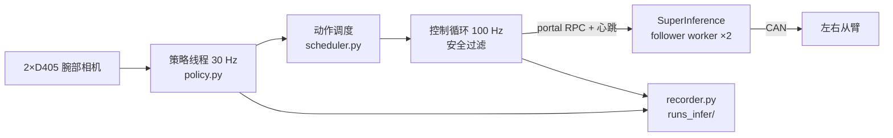

# YAM_Inference

在 I2RT YAM 双臂从臂上运行 ACT 模仿学习策略的**推理框架**（训练在 `opus_inference_train`）。

## 模块

| 文件 | 作用 |
|---|---|
| `yam_infer/run.py` | 主程序：对齐 → 回合循环 → 归位断电 |
| `yam_infer/policy.py` | 加载 `.pt`、与训练一致的图像预处理 |
| `yam_infer/model/act.py` | 网络结构（需与训练端一致） |
| `yam_infer/scheduler.py` | chunk 承诺执行 / 时间集成 + 安全过滤（范围、速度、夹爪挤压） |
| `yam_infer/robot.py` | 启动并控制 SI follower worker（心跳、故障恢复、随主程序退出） |
| `yam_infer/cameras.py` | D405 读取；录制回放（离线演练） |
| `yam_infer/recorder.py` | 每回合记录，供复盘 |
| `yam_infer/server.py` | 可选：远程 GPU 推理 |
| `yam_infer/nedf3.py` | 读 MCAP 录制（仅离线演练用） |
| `yam_infer/tools/review.py` | 复盘：曲线 + 视频 |
| `yam_infer/tools/stop_all.py` | 残留手臂归位并关闭所有进程 |
| `yam_infer/tools/export.py` | 训练 ckpt → 部署模型（去掉优化器状态） |

## 使用

| 步骤 | 命令 |
|---|---|
| 安装（一次） | `bash scripts/setup_robot.sh` |
| 本机配置 | `robot.env`：`SI_ROOT=…SuperInference 路径`、`CKPT=models/act_v2_all.pt` |
| 离线演练 | `.venv/bin/python -m yam_infer.run --ckpt models/act_v2_all.pt --task put_banana_in_bowl --dry-run <episode_dir>` |
| 真机 | `bash scripts/run_robot.sh banana` / `block` |
| 复盘 | `.venv/bin/python -m yam_infer.tools.review runs_infer/<run> --video` |
| 全部关闭 | `bash scripts/stop_all.sh` |

| 按键（+回车） | 作用 |
|---|---|
| 回车 | 开始 / 暂停 / 继续 |
| `r` | 结束本回合 → 回起始姿态 |
| `q` | 归位到启动时的休息姿态 → 断电 |

## 模型文件约定（训练端导出）

| 键 | 内容 |
|---|---|
| `model`, `config` | 权重与 `ACTConfig` |
| `stats`, `action_norm`, `action_mode` | 归一化；`abs` 或 `delta` 动作 |
| `tasks`, `cameras`, `image_size`, `fps` | 任务名、相机顺序 `[right_wrist, left_wrist]`、240×320、30 Hz |
| `start_pose` | 各任务示范平均起始姿态 |
