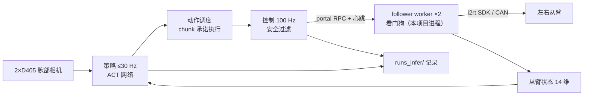

# YAM_Inference

在 I2RT YAM 双臂机器人上运行 **ACT 模仿学习策略**的推理框架：两路腕部相机 + 从臂状态 → 网络预测未来 1.67 秒动作 → 安全过滤 → 从臂执行，每回合完整记录供复盘。

**自包含**：真机只需本仓库 + 本仓库 `.venv`。从臂 worker 和 i2rt SDK 已从 SuperInference 搬入（见 [VENDORED.md](VENDORED.md)）。

## 文档

| 文档 | 内容 |
|---|---|
| [01_background.md](docs/01_background.md) | **知识背景**：模仿学习、主从臂、ACT（分块 / CVAE / 增量动作）、执行模式、看门狗与安全层、训练结果 |
| [02_architecture.md](docs/02_architecture.md) | **项目结构与代码**：目录、进程线程、生命周期、每个模块、配置与文件格式 |
| [03_scripts.md](docs/03_scripts.md) | **脚本与命令**：每个脚本的流程、全部参数、演练、复盘、收尾 |
| [04_setup.md](docs/04_setup.md) | **从零配置环境**：前置条件、部署、安装、首跑、常见问题 |
| [05_robot_log.md](docs/05_robot_log.md) | 真机记录、独立版首跑检查单 |
| [06_development.md](docs/06_development.md) | **持续开发**：开发循环、测试、常见改动该动哪里、跟进上游 |
| [VENDORED.md](VENDORED.md) | 搬运来的代码清单与本地改动 |

## 快速上手

| 步骤 | 在哪 | 命令 |
|---|---|---|
| 代码（git）+ 模型放到机器人 | 用户电脑 | `models/*.pt` 不进 git，单独拷贝 |
| 安装 + 自检（一次） | 机器人 | `bash scripts/setup_robot.sh --dev` → `ALL OK` |
| 本机配置（一次） | 机器人 | `cp robot.env.example robot.env`；核对 `configs/hardware.yaml` |
| 测试 | 两边 | `.venv/bin/python -m pytest -q` |
| 离线演练 | 两边 | `.venv/bin/python -m yam_infer.run --ckpt models/act_v2_all.pt --task put_banana_in_bowl --dry-run <录制目录> [--fake-arms]` |
| 真机 | 机器人 | 先关采集 WebUI → `bash scripts/run_robot.sh banana`（或 `block`） |
| 复盘 | 两边 | `.venv/bin/python -m yam_infer.tools.review runs_infer/<目录> --video` |
| 硬件被占用 | 机器人 | `bash scripts/free_hw.sh`（`run_robot.sh` 会自动调用） |
| 归位 | 机器人 | `bash scripts/home_arms.sh`（不管 worker 什么状态） |

| 按键（+回车） | 作用 |
|---|---|
| 回车 | 开始 / 暂停 / 继续 |
| `r` | 结束本回合 → 回起始姿态 |
| `q` | 回休息姿态 → 断电退出 |

## 一览

| 项 | 值 |
|---|---|
| 模型 | ACT，51.6 M 参数，ResNet18 + Transformer，增量关节动作，chunk 50 @ 30 Hz |
| 任务 | `put_banana_in_bowl`、`put_blue_block_in_blue_cup`（一个模型两个任务） |
| 默认模型 | `models/act_v2_all.pt`；备用 `models/act_v2_delta_s15k.pt`（不进 git） |
| 机器人 | `team1@10.128.1.165:~/fufu/yam_infer`，Ubuntu 22.04，RTX 5090，Python 3.10，torch 2.7.1+cu128 |
| 硬件配置 | `configs/hardware.yaml`（左从臂 can3 :1234，右从臂 can2 :1235，夹爪 crank_4310，相机序列号） |
| 训练项目 | `~/Dev/MVIG/opus_inference_train`（改网络结构时同步 `yam_infer/policy/act.py`） |

## 代码地图

| 路径 | 作用 |
|---|---|
| `yam_infer/run.py` | 主程序：对齐 → 回合循环 → 归位断电 |
| `yam_infer/policy/` | 模型加载 / 预处理 / ACT 网络 / 远程推理 |
| `yam_infer/control/scheduler.py` | 动作调度 + 安全过滤 |
| `yam_infer/hw/arms.py` | 启动并驱动两个 worker；模拟臂 |
| `yam_infer/hw/follower/` | worker 进程：看门狗 + i2rt SDK（从 SI 搬来） |
| `yam_infer/hw/cameras.py` | D405；录制回放 |
| `yam_infer/data/` | 每回合记录；读 MCAP 录制 |
| `yam_infer/tools/` | `review` 复盘、`free_hw` 释放硬件、`home_arms` 归位、`export` 导出 |
| `third_party/i2rt/` | I2RT SDK（MIT，裁剪） |
| `tests/` | 无硬件测试 |
