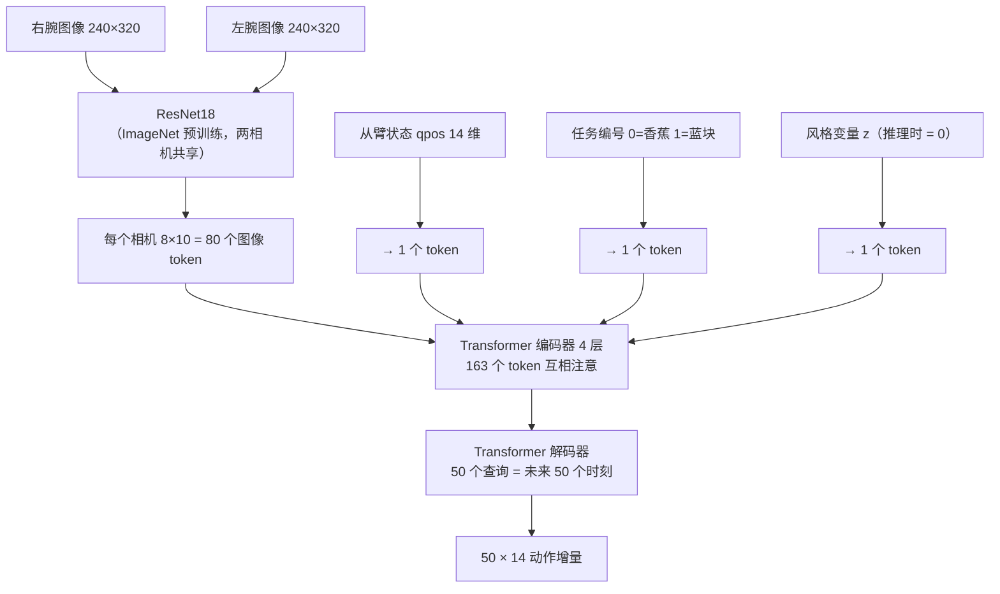
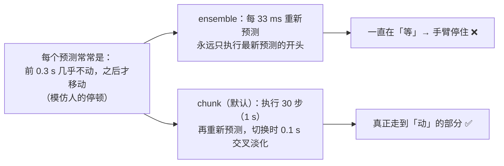

# 01 知识背景

## 1. 整件事在做什么：模仿学习

| 术语                | 含义                                                                                                                                  |
| ------------------- | ------------------------------------------------------------------------------------------------------------------------------------- |
| 模仿学习 / 行为克隆 | 看人的示范，学「看到这样的画面和姿态 → 人会怎么动」，不需要奖励函数                                                                   |
| 主臂 leader         | 人手握着操作的那只臂，不带负载，只读角度                                                                                              |
| 从臂 follower       | 真正干活的臂，跟随主臂角度；**推理时只用从臂，主臂不启动**                                                                            |
| 示范 episode        | 一次完整的任务录制（12–25 秒）                                                                                                        |
| 开环 / 闭环         | 开环：拿录好的画面喂模型、比对答案（离线评估）；闭环：模型的动作改变真实世界，下一帧画面来自它自己的结果（真机）。**开环好 ≠ 闭环好** |

## 2. 硬件与数据

| 项     | 值                                                                                                                     |
| ------ | ---------------------------------------------------------------------------------------------------------------------- |
| 机器人 | I2RT YAM 双臂，每臂 6 个关节 + 1 个夹爪，电机 DM4310，经 CAN 总线（can0–can3）通信                                     |
| 相机   | 两个 Intel RealSense D405，分别装在左右手腕上，640×480 RGB 30 fps                                                      |
| 任务   | `put_banana_in_bowl`（香蕉放进碗，31 条示范）、`put_blue_block_in_blue_cup`（2–6 个色块中把唯一的蓝块放进蓝杯，50 条） |
| 数据量 | 81 条，共约 24 分钟，全部是成功示范                                                                                    |

### 14 维向量（全项目统一）

| 下标 | 0–5                  | 6                | 7–12                 | 13               |
| ---- | -------------------- | ---------------- | -------------------- | ---------------- |
| 含义 | 左臂 6 个关节（rad） | 左夹爪 0 闭–1 开 | 右臂 6 个关节（rad） | 右夹爪 0 闭–1 开 |

`qpos`（从臂当前状态）、模型输出的动作、下发给从臂的目标，都是这个格式。

## 3. 模型：ACT（Action Chunking with Transformers）

ACT 是专为「主从臂遥操作 + 几十条示范」设计的模型（原论文的 ALOHA 双臂和 YAM 形态相同），一次前向就输出动作，速度快。

| 参数                         | 值                                             |
| ---------------------------- | ---------------------------------------------- |
| 参数量                       | 51.6 M（ResNet18 约 11 M，其余是 Transformer） |
| d_model / heads              | 512 / 8                                        |
| 编码器 / 解码器 / 风格编码器 | 4 / 1 / 4 层                                   |
| chunk                        | 50 步 @ 30 Hz = 1.67 秒                        |

### 3.1 动作分块（Action Chunking）

| 每次只预测 1 步            | 每次预测 50 步（ACT）              |
| -------------------------- | ---------------------------------- |
| 小误差逐步累积 → 越走越偏  | 动作连贯，相当于「一口气规划一段」 |
| 人的停顿和抖动会让模型犹豫 | 对停顿和抖动不敏感                 |

### 3.2 CVAE 风格变量 z

人每次做同一件事，快慢路线都不一样。训练时用一个「风格编码器」把真实动作压成 32 维的 z，告诉网络「这次是哪种风格」；**推理时 z = 0，即最常见的风格**，所以同一输入的输出是确定的。

### 3.3 增量动作（delta）

|                            | 绝对动作（v1）                           | 增量动作（v2，当前）          |
| -------------------------- | ---------------------------------------- | ----------------------------- |
| 网络输出                   | 「右臂第 2 关节 = 1.95 rad」             | 「在当前位置上 +0.05 rad」    |
| 不动的左臂                 | 要背出绝对角度，偏差 0.03 rad → 左臂乱动 | 输出 ≈ 0 就行，偏差 0.007 rad |
| 下一步误差（右臂，验证集） | 0.042 rad                                | **0.020 rad**                 |

推理时：`目标 = 当前 qpos + 网络输出 × 标准差 + 均值`（反归一化后相加，见 `yam_infer/policy/policy.py`）。

### 3.4 动作标签用的是主臂

从臂比主臂慢约 130 ms。训练标签是**主臂**（人的意图），所以模型输出的目标会「领先」从臂当前位置一点，这是正常的。

## 4. 推理时的关键概念

### 4.1 两个频率

| 循环         | 频率       | 做什么                                                   |
| ------------ | ---------- | -------------------------------------------------------- |
| 策略（模型） | 最高 30 Hz | 拍照 + 读状态 → 预测未来 50 步                           |
| 控制         | 100 Hz     | 从最近的预测里插值出「此刻」的目标 → 安全过滤 → 发给从臂 |

### 4.2 执行方式：chunk 承诺 vs 时间集成

| 模式            | 参数                | 说明                                                                                                          |
| --------------- | ------------------- | ------------------------------------------------------------------------------------------------------------- |
| `chunk`（默认） | `--exec-horizon 30` | 犹豫/停住 → 调大到 40–50；动作太「莽」→ 调小到 15–20                                                          |
| `ensemble`      | `--ensemble-m 0.01` | ACT 原文的时间集成：同一时刻被多次预测，按 `exp(-m·i)` 加权平均。m>0 老预测占优（平滑但滞后），m<0 新预测占优 |

### 4.3 预处理必须和训练一致

| 步骤     | 训练数据             | 推理                                                  |
| -------- | -------------------- | ----------------------------------------------------- |
| 相机流   | D405 640×480 rgb8    | 同                                                    |
| JPEG     | 采集时 q90 压缩保存  | 默认也做一次 q90 编解码（`--no-jpeg-roundtrip` 关闭） |
| 缩放     | INTER_AREA → 320×240 | 同                                                    |
| 相机顺序 | [右腕, 左腕]         | 同（从模型文件读取）                                  |

任何一项不一致，网络看到的画面「风格」就和训练不同，效果会明显变差。

### 4.4 从臂 worker 与看门狗

主程序**不直接碰 CAN**：每只从臂由一个独立的 worker 进程（`yam_infer/hw/follower/worker.py`）独占 CAN 总线，主程序通过 RPC（`portal` 库）给它发目标。worker 是从采集项目 SuperInference（SI）原样搬来的（见 [VENDORED.md](../VENDORED.md)），采集时验证过的保护全部保留，但现在跑在本项目自己的环境里，不再需要 SI：

| 保护         | 规则                                                                               |
| ------------ | ---------------------------------------------------------------------------------- |
| 过期指令拒收 | 指令发出超过 50 ms 才到 → 丢弃                                                     |
| 指令租约     | 150 ms 没收到新指令 → FAULT，并原地保持（主程序有心跳线程防止这种情况）            |
| 跟随误差     | 目标与实际差 > 1 rad → FAULT                                                       |
| SDK          | 关节限位                                                                           |
| 断电行为     | worker 退出 = 电机零力矩（**手臂会软掉落下**）→ 所以退出前必须先「归位」到休息姿态 |

控制会话的阶段：`begin_control_session → ALIGNING（对齐） → ACTIVE（运行） → end_control_session（原地保持）`。

### 4.5 本项目额外加的安全层

| 层                 | 规则                                                       | 参数                     |
| ------------------ | ---------------------------------------------------------- | ------------------------ |
| 范围限制           | 关节目标限制在示范出现过的范围 ± 0.15 rad；夹爪 0–1        | `--margin`               |
| 速度限制           | 关节 ≤ 1.5 rad/s，夹爪 ≤ 3 /s                              | `--max-joint-speed`      |
| 手臂冻结（默认都关） | 被冻结的臂保持回合开始时的位置，不跟网络输出 | `run.yaml` `control.freeze_left/right`，`--[no-]freeze-left/right` |
| 回合时长上限       | 40 s（`configs/run.yaml`）                                 | `episode.max_seconds` / `--max-seconds` |
| 心跳               | 等待按键 / 回合之间也持续重发最后一个目标，防止租约超时    | 自动                     |
| 不留孤儿进程       | 主程序死掉，worker 自动收到 SIGTERM 退出                   | 自动                     |
| 人                 | 回车暂停、`q` 退出，**手放在急停旁**                       | —                        |

## 5. 训练端概要（训练代码不在本项目）

| 项       | 值                                                                                                                         |
| -------- | -------------------------------------------------------------------------------------------------------------------------- |
| 代码     | `~/Dev/MVIG/opus_inference_train`（数据转换、训练、离线评估）                                                              |
| 服务器   | 4×H20，batch 128，bf16，AdamW lr 1e-4（ResNet 2e-5）                                                                       |
| 损失     | L1（预测 vs 主臂真实动作）+ 10 × KL（约束 z）                                                                              |
| 数据增强 | 小平移/缩放/旋转、亮度/对比度/饱和度；**不改色相**（否则分不清蓝色）                                                       |
| 交付模型 | `act_v2_all.pt`：增量动作，全部 81 条训练 15k 步（默认）；`act_v2_delta_s15k.pt`：73 条训练 + 8 条验证，有验证依据（备用） |

| 模型（验证集 8 条，开环） | 下一步误差 右臂        | 左臂      | 右夹爪    |
| ------------------------- | ---------------------- | --------- | --------- |
| v1 绝对动作 @5k           | 0.042 rad              | 0.028     | 0.078     |
| **v2 增量动作 @15k**      | **0.021 rad（≈1.2°）** | **0.007** | **0.066** |

> 黑 = 人（主臂）、红 = 模型、蓝虚线 = 从臂实际。中段偏差主要在「什么时候开始动」：同样的画面，人有时停顿久一点。

| 观察                                 | 解释                                                     |
| ------------------------------------ | -------------------------------------------------------- |
| train 误差持续下降，val 停在约 0.085 | 数据少，模型能「背下」训练集；远期预测本身不确定 → 正常  |
| val 没有明显上升                     | 没有严重过拟合，15k 和 30k 差别很小                      |
| KL → 1e-5                            | z 基本没用上（示范风格很一致），推理时本来就用 z=0，无害 |

> 上面是旧 act_v2 模型。当前训练主线 yam_train（act_ref）按官方 ACT 源码：一个任务一个模型、480×640 原图、chunk 100；推理端两种都支持，对照见 `02_architecture.md` 的「policy/」一节。
