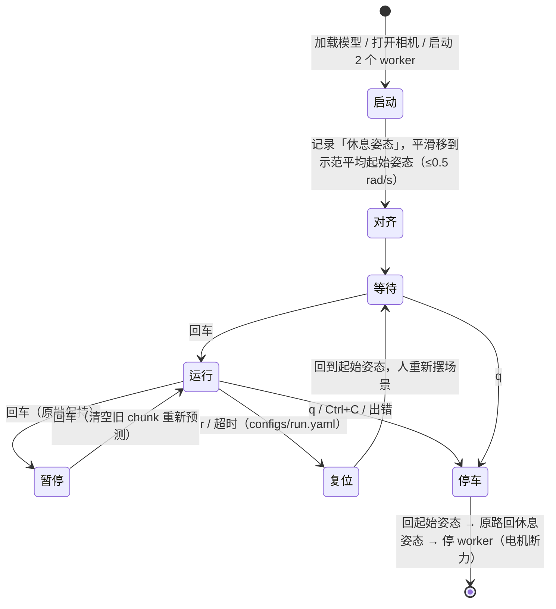
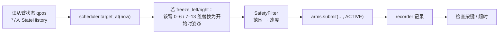
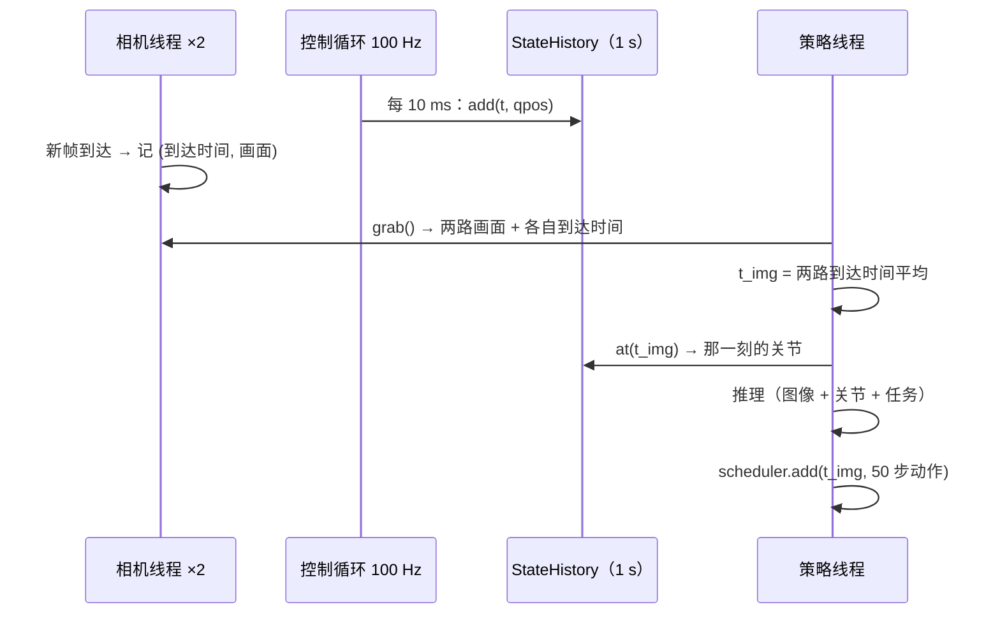
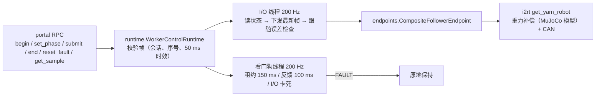
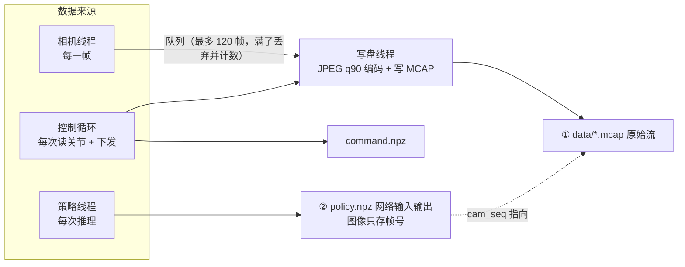
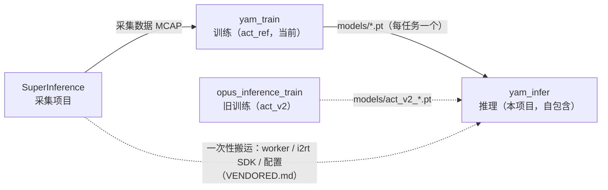

# 02 项目结构与代码说明

> 目标：不读代码，也能知道每个文件做什么、数据怎么流动、出了问题该看哪里。
> 本项目**自包含**：真机运行只需要本仓库 + 本仓库的 `.venv`，不再需要 SuperInference（SI）。

## 1. 目录

```text
yam_infer/
├── README.md               入口：概览 + 快速上手
├── VENDORED.md             从 SI / i2rt 搬来的代码清单与本地改动（改动时更新）
├── AGENTS.md / SEVERS.md   给 AI 助手的约定 / 机器说明
├── pyproject.toml          包信息、pytest / ruff 配置
├── requirements.txt        机器人上的固定版本依赖（torch 除外）
├── pyrightconfig.json      类型检查把 third_party/i2rt 加入路径
├── robot.env.example       机器人本机配置模板（复制为 robot.env，不进 git）
├── configs/
│   ├── hardware.yaml         两只从臂（CAN 口、RPC 端口、看门狗参数）+ 相机序列号
│   ├── models.yaml           本次运行的那一个模型 + 怎么解读它（格式、任务、增量/绝对）
│   ├── rest_pose.yaml        休息姿态（home_arms 的归位目标）
│   └── run.yaml              运行参数（执行方式 execution.*、回合时长 episode.max_seconds）
├── docs/                   本文档
├── scripts/                一键脚本（见 03_scripts.md）
├── tests/                  不需要硬件的自动测试（pytest）
├── third_party/i2rt/       I2RT 机械臂 SDK（MIT，已裁剪，代码未改）
├── models/                 模型文件 *.pt（不进 git）
└── yam_infer/              Python 包
    ├── run.py                主程序（入口）
    ├── policy/               「大脑」：网络
    │   ├── policy.py           模型加载（两种格式）+ 预处理 + 推理
    │   ├── act.py              旧 act_v2 网络（opus_inference_train 训练的模型）
    │   ├── act_ref.py          act_ref 模型的推理封装（= 官方 ACTPolicy 推理分支）
    │   ├── detr/               官方 ACT 网络代码（从 yam_train 原样拷贝）
    │   └── server.py           可选：远程 GPU 推理服务
    ├── control/              「小脑」：动作怎么执行
    │   ├── scheduler.py        chunk 调度 + 安全过滤
    │   └── state_history.py    最近 1 s 的关节记录：按图像时间插值关节（图像↔关节对齐）
    ├── hw/                   硬件
    │   ├── arms.py             主进程侧：启动/驱动两个 worker；模拟臂 SimArms
    │   ├── cameras.py          D405 相机；录制回放
    │   └── follower/           worker 进程侧（从 SI 搬来）
    │       ├── worker.py         一个进程 = 一只从臂，RPC 服务
    │       ├── runtime.py        控制循环 + 看门狗（与 SI 逐字节一致）
    │       ├── config.py         hardware.yaml 解析与校验（与 SI 逐字节一致）
    │       └── endpoints.py      i2rt SDK → 7 维接口；FakeFollowerEndpoint
    ├── data/                 读写数据
    │   ├── recorder.py         每回合录制（原始流 + 网络输入输出 + 事件）
    │   ├── nedf3_writer.py     写 NEDF3 兼容 MCAP
    │   ├── nedf3_schemas/      NEDF3 的 protobuf 定义（从 SI 录制提取）
    │   └── nedf3.py            读 NEDF3 录制（SI 采集 / 本项目录制）
    └── tools/                独立小工具
        ├── review.py           复盘（新旧两种录制格式）
        ├── replay_policy.py    用录制离线重跑模型、对比输出
        ├── free_hw.py          谁占着 CAN/相机/端口 → 交互式停止
        ├── home_arms.py        任何状态下把手臂归位再断电
        └── export.py           训练 ckpt → 部署模型
```

| 只在机器人上、不进 git | 说明 |
|---|---|
| `.venv/` | Python 环境（`setup_robot.sh` 生成） |
| `robot.env` | 本机配置（模型路径等） |
| `sample_episodes/` | 离线演练用的录制 |
| `runs_infer/`、`runs_infer_dryrun/` | 推理记录 |

## 2. 进程与线程

```mermaid
flowchart TB
    subgraph MAIN["主进程 yam_infer.run（.venv/bin/python）"]
        KEY["按键线程"]
        CAM["相机线程 ×2<br/>只保留最新一帧 + 到达时间"]
        HIST[("StateHistory<br/>最近 1 s 关节")]
        POL["策略线程 ≤30 Hz<br/>需要新 chunk 时才推理（GPU）<br/>关节取图像时刻的插值"]
        SCH[("ActionScheduler")]
        CTRL["控制循环 100 Hz（主线程）<br/>插值 → 冻结（可选）→ 安全过滤 → 下发"]
        HB["心跳线程<br/>>30 ms 没下发就重发上一个目标"]
        REC["RunRecorder"]
        CAM --> POL --> SCH --> CTRL
        CTRL -->|"每 10 ms 写入"| HIST -->|"at(t_img)"| POL
        KEY --> CTRL
        POL & CTRL --> REC
        CTRL --> HB
    end
    subgraph WK["worker 子进程 ×2（同一个 .venv，python -m yam_infer.hw.follower.worker）"]
        WL["左臂 worker :1234<br/>I/O 线程 + 看门狗线程"]
        WR["右臂 worker :1235<br/>I/O 线程 + 看门狗线程"]
    end
    CTRL & HB -->|"portal RPC<br/>submit_control_frame"| WL & WR
    WL -->|"i2rt SDK / CAN can3"| AL["左从臂"]
    WR -->|"i2rt SDK / CAN can2"| AR["右从臂"]
```



为什么 worker 要单独进程：CAN 读写可能卡住，单独进程 + 独立看门狗线程保证「主程序卡住 / 崩溃时，手臂仍会在 150 ms 内进入保持」；主程序死掉时 worker 也会被内核通知退出（`PR_SET_PDEATHSIG`）。

## 3. 一次运行的生命周期（`run.py`）



| 函数 | 作用 |
|---|---|
| `main()` | 解析参数，组装 policy / cams / arms，循环调用 `run_episode`，`finally` 里一定停车 |
| `run_episode()` | 一个回合：等回车 → 起策略线程 → 100 Hz 控制循环 → 写记录。返回 `next` / `quit` |
| `smooth_move()` | 三次 smoothstep 平滑移动，峰值速度受限，至少 2 秒 |
| `park_and_release()` | 停车：失败先 `recover()`（清故障、重开会话）再试一次，然后关 worker |

### 控制循环每 10 ms 做的事



### 图像与关节的时间对齐（策略线程每次推理）

模型的一个输入 = 两路图像 + 「拍到这张图那一刻」的关节。推理时按训练数据的配对方式重建这个组合：

| | 训练数据（opus_inference_train 数据转换） | 推理（本项目） |
|---|---|---|
| 时间来源 | 录制时的本机时间：相机 = 程序拿到画面的时刻，关节 = 读完全部关节的时刻 | 同样的定义：相机 = 相机线程拿到画面的时刻，关节 = 控制循环读完的时刻（同一个 `time.monotonic()` 时钟） |
| 配对 | 30 Hz 时间点 t：关节在 t 线性插值，图像取离 t 最近的一帧 | 观测时刻 `t_img` = 两路图像到达时间的平均；关节 = `StateHistory.at(t_img)`（相邻两次读数线性插值） |
| 动作 | 样本 t 的标签是 a(t)…a(t+49) | 这次预测的 50 步从 `t_img` 开始排时间；图像年龄 + 推理延迟对应的前几步会被调度器自动跳过 |



| 仍然存在、无法消除的 | 说明 |
|---|---|
| 「到达时间」≠ 曝光时刻 | 训练数据也是到达时间（SI 故意不用 RealSense 硬件时间戳），两边一致 |
| 左右相机不同步 | 两个 D405 各自出图，相差 0–33 ms；训练数据里同样存在，取平均作折中 |

记录：`policy.npz` 的 `t` = `t_img`，`qpos` = 插值出的关节，`cam_t` = 每路图像到达时间，`t_infer` = 开始推理时刻（`t_infer - t` = 图像年龄）。

## 4. 模块逐个说明

### `policy/`：网络

两种模型格式，`Policy` 按 checkpoint 的 `format` 字段自动选择：

| | act_v2（旧） | act_ref（`yam_train/act_ref-v1`，当前训练主线） |
|---|---|---|
| 训练项目 | opus_inference_train | yam_train（按官方 ACT 源码） |
| 网络代码 | `policy/act.py` | `policy/detr/`（官方源码，未改）+ `policy/act_ref.py` |
| 任务 | 一个模型多个任务，任务编号作为输入 | 一个模型一个任务 |
| 输入图像 | JPEG 往返 → 缩放到 240×320 | JPEG 往返，**不缩放**（480×640） |
| chunk | 50 | 100 |
| 动作对齐 | 第 0 步 = 主臂(t) | 第 0 步 = 主臂(t−1)（`action_shift: 1`，见 `models.yaml` 的 `compensate_action_shift`） |
| 计算精度（GPU） | bf16 | fp32（同源码） |
| 归一化 / 安全范围 | `stats.qpos/action`、`action_norm` | `stats.qpos_mean/std`、`action_mean/std`、`leader_min/max` |

| 成员 | 作用 |
|---|---|
| `policy.preprocess_frame()` | 原图 → JPEG q90 编解码（与录制同一个编码器）→ 缩放到模型的 `image_size`（尺寸相同就不缩放） |
| `policy.Policy` | 读 `.pt`，按格式重建网络、载入权重和统计量；检查任务是否在模型的 `tasks` 里 |
| `Policy.predict()` | 两路图像 + 14 维 qpos + 任务名 → `(chunk, 14)` **绝对**关节目标；`last_raw` 是网络原始输出 |
| `act_ref.ACTRefPolicy` | 官方 `ACTPolicy` 的推理分支：ImageNet 归一化 → `DETRVAE`（z = 0）。建网络时临时让 `is_main_process()` 返回 False，避免下载 ImageNet 权重（权重随后从 checkpoint 载入） |
| `server.py` | 机器人没 GPU 时远程推理；协议：4 字节长度 + JSON 头 + JPEG（不用 pickle） |

### `control/scheduler.py`

| 类 | 作用 |
|---|---|
| `ActionScheduler` | 存最近的 chunk（带拍照时刻），`target_at(t)` 线性插值。`chunk` 模式执行 `horizon` 步才换，切换 0.1 s 交叉淡化；`ensemble` 模式加权平均 |
| `SafetyFilter` | ① 关节限制在示范范围 ± margin、夹爪 0–1 ② 速度上限（关节 1.5 rad/s、夹爪 3 /s）；统计触发次数 |

### `control/state_history.py`

| 成员 | 作用 |
|---|---|
| `StateHistory.add(t, qpos)` | 控制循环每次读完关节写入；只保留最近 1 s（100 条），时间必须递增 |
| `StateHistory.at(t)` | t 时刻的关节：两侧读数线性插值；超出范围取最早 / 最新一条 |

### `hw/arms.py`：主进程侧的从臂

| 成员 | 作用 |
|---|---|
| `FollowerArms(hw_config, log_dir, fake=False)` | 检查端口没被占用 → 用本进程的 Python 启动两个 worker（`PYTHONPATH` 加上 `third_party/i2rt`）→ 等端口就绪 → portal RPC |
| `begin / activate / end` | 开会话（ALIGNING）/ 等 worker 应用了对齐帧后切 ACTIVE / 结束会话（原地保持） |
| `submit()` | 下发 14 维目标（拆成左右各 7 维） |
| 心跳线程 | 每 10 ms 检查，>30 ms 没下发就重发，保证 150 ms 租约不过期 |
| `recover()` | FAULT 后：清故障 → 新会话 → 保持当前位置 |
| `close()` | 结束会话 → 终止 worker（**零力矩**），所以一定先停车 |
| 端口占用保护 | 1234/1235 已被别人（如采集 WebUI 的 worker）占用 → 拒绝启动，绝不连到别人的 worker |
| `SimArms` | 离线演练：一阶滞后（约 130 ms）追随目标，不起 worker |
| 日志 | `runs_infer/worker_left.log`、`worker_right.log` |

### `hw/follower/`：worker 进程侧（从 SI 搬来）



| 文件 | 作用 | 与 SI 的关系 |
|---|---|---|
| `worker.py` | 解析参数 → 建 endpoint → 启 runtime → 起 RPC 服务；SIGTERM 时先保持再断电 | 改编（仅从臂、标准 logging、`--fake`） |
| `runtime.py` | 会话/阶段状态机、帧校验、看门狗、跟随误差故障 | 逐字节一致 |
| `config.py` | `hardware.yaml` 严格校验（端口/CAN 唯一、数值范围） | 逐字节一致 |
| `endpoints.py` | i2rt 机械臂 → 7 维 `get_info / command_joint_pos`；`FakeFollowerEndpoint` 给测试用 | 改编（仅 `i2rt_can` 夹爪） |

### `hw/cameras.py`

| 成员 | 作用 |
|---|---|
| `resolve_serials()` | 序列号：命令行 > 环境变量 `YAM_{LEFT,RIGHT}_CAM_SERIAL` > `hardware.yaml` 的 `cameras:` |
| `RealSenseCamera` / `CameraRig` | 后台线程取帧，只保留最新；`grab()` 返回每路画面 + 到达时间；拒绝超过 0.2 s 的旧帧 |
| `ReplayCameraRig` | 离线演练：按时间回放录制画面 |

### `data/`：录制

| 文件 | 作用 |
|---|---|
| `recorder.py` | 每回合录制：原始流 + 网络输入输出 + 事件；结束时检查完整性 |
| `nedf3_writer.py` | 写 NEDF3 兼容 MCAP（和 SI 采集同样的话题和 protobuf 定义）；`encode_jpeg_rgb` 是录制和模型预处理共用的 JPEG 编码 |
| `nedf3_schemas/*.desc` | 从 SI 录制里提取的 protobuf 定义（`scripts/extract_nedf3_schemas.py`），不需要 SI 的私有包 |
| `nedf3.py` | 读 NEDF3 录制：SI 的采集数据和本项目的推理录制都能读（`--dry-run` 可以直接回放推理录制） |

#### 一个回合目录（`runs_infer/<时间>_<任务>/`，录制中名为 `…_inprogress`）

录制窗口：从按回车开始，到本回合结束。回合前后的对齐、复位、停车动作不录。



| 文件 | 内容 |
|---|---|
| `metadata.json` | NEDF3 元数据：任务、相机映射（camera_0 = 右腕，camera_1 = 左腕）、14 维布局 |
| `data/*.mcap` ① | **原始流**，话题与 SI 采集一致：`nmx/hal/camera/camera_0\|1/rgbd`（每一帧，JPEG q90；`header.seq` = 帧号，`header.stamp` = RealSense 硬件时间 ns，`frame_id` = 相机名）；`nmx/hal/i2rt/follower/{left,right}/joint` 和 `/hand_state`（每次读数，约 100 Hz）。没有主臂话题 |
| `policy.npz` ② | 每次推理一行：`t`（观测时刻 = 两路图像到达时间平均）、`cam_t` / `cam_seq`（所用每路图像的到达时间和帧号）、`qpos`（`t` 时刻插值出的关节 = 模型输入）、`raw_out`（网络原始输出，归一化值；`--remote` 时为 NaN）、`chunk`（50 步绝对目标，第 k 步在 `t + k/30`）、`t_infer` / `t_done` / `latency_ms` |
| `command.npz` | 100 Hz：`t`（读完关节的时刻）、`qpos`、`target_raw`（模型目标）、`target_safe`（实际下发）、`t_sample`（左/右 worker 的采样时刻） |
| `events.jsonl` | start / pause / resume / end（原因），每条带单调时间和墙钟时间 |
| `episode_stats.json` | 各话题条数、丢弃帧数、写盘错误、图像年龄（中位 / 最大） |
| `meta.json` | 模型路径与 sha256、代码版本（git）、全部参数、`hardware.yaml` / `run.yaml` 原文、时钟对应关系、结束原因、安全层统计 |
| `worker_*.log` | worker 日志副本（不会再被下一次运行覆盖） |

| 设计点 | 说明 |
|---|---|
| 模型输入图不另存 | 推理时的 JPEG 往返和录制用的是同一个编码函数，所以「录下的 JPEG 解码」就等于模型看到的图（缩放前）。`tools/replay_policy.py` 用帧号取回、缩放后重跑模型，CPU 上与现场输出的差 < 1e-6 |
| 时间 | npz / jsonl 里都是单调时钟秒；MCAP `log_time` = 墙钟 ns，由单调时钟加上开始时测的一个固定偏移换算，中途系统校时不会跳变（`meta.json` 的 `clock`） |
| 不拖慢控制 | 相机帧和关节都只是入队，JPEG 编码和写盘在独立线程 |
| 完整性 | 结束时任一话题为空或写盘出错 → 移到 `runs_infer/quarantine/` 并写 `quarantine_reason.json`；程序崩溃留下的 `…_inprogress` 下次启动时移入 `quarantine/`（`…_interrupted`）；没按回车就退出的回合不留目录 |
| 与 SI 的差别 | 同一套 schema，但 `header.seq/stamp` 有值（SI 为 0）、夹爪 100 Hz（SI 30 Hz）、在数据产生处直接录（SI 是轮询共享内存）、没有主臂 |

旧格式（`frames.mp4`，10-28 及以前的记录）仍可用 `review.py` 打开。

### `tools/`

| 文件 | 作用 |
|---|---|
| `review.py` | 健康摘要 + `review.png`（每个关节目标/下发/实际、延迟、图像年龄），`--video` 生成 `review.mp4`；新旧录制格式都支持 |
| `replay_policy.py` | 按 `policy.npz` 的帧号从 MCAP 取回图像，用记录的关节离线重跑模型，打印与现场输出的最大差 |
| `free_hw.py` | 按真实占用（CAN socket、RPC 端口监听/连接、RealSense 设备、CAN 口状态）找出阻止开机械臂的程序，按所属程序分组，交互式停止；需要时用 sudo |
| `home_arms.py` | 任何 worker 状态下归位：能用现有 worker 就用 RPC；否则调 `free_hw` 释放后起本项目 worker；最后在休息姿态断电 |
| `export.py` | 训练 ckpt 去掉优化器状态 → 部署 `.pt` |

## 5. 配置文件

### `configs/run.yaml`

命令行同名参数优先；启动时打印最终值并写进每个回合 `meta.json` 的 `settings`；缺键、多余键、超范围都直接报错。

| 键 | 默认 | 内容 |
|---|---|---|
| `execution.mode` | chunk | chunk：一个计划执行 `horizon` 步再换；ensemble：每帧重新规划并加权平均（`--exec-mode`） |
| `execution.horizon` | 30 | chunk 模式每个计划执行的步数 = 重新看图的间隔（30 步 = 1 s），1 到模型的 chunk 长度（act_v2 50、act_ref 100）（`--exec-horizon`） |
| `execution.blend_s` | 0.1 | chunk 模式新旧计划交叉淡化时长 s，0 = 直接切换（`--blend-s`） |
| `execution.ensemble_m` | 0.01 | ensemble 模式权重 exp(-m·i)：>0 老计划占优（平滑），<0 新计划占优（灵敏）（`--ensemble-m`） |
| `episode.max_seconds` | 40.0 | 单回合最长时间（秒），到时结束本回合（`--max-seconds`） |

`horizon`、`blend_s` 只在 chunk 模式生效，`ensemble_m` 只在 ensemble 模式生效（启动时只打印当前模式用到的值）。

| 想和官方 ACT（`../policy/act/imitate_episodes.py`）一致 | 配置 | 仍然存在的差别 |
|---|---|---|
| 默认（不加 `--temporal_agg`）：每 `chunk_size` 步看一次图，整段执行完再换 | `mode: chunk`、`horizon: 50`、`blend_s: 0` | 官方是同步的（等推理完再走下一步），我们是异步的：新计划从拍照时刻开始排时间，推理期间旧计划的最后一步会保持约 1–2 个控制周期 |
| `--temporal_agg`：每步都重新推理，权重 exp(-0.01·i)，i = 0 是最老的计划 | `mode: ensemble`、`ensemble_m: 0.01` | 官方每个控制步推理一次（仿真 50 Hz）、按步号对齐；我们推理 ≤30 Hz、控制 100 Hz，按时间插值对齐 |

### `configs/rest_pose.yaml`

| 键 | 内容 |
|---|---|
| `left` / `right` | 各 7 个数：6 个关节（rad）+ 夹爪（0 闭–1 开）；`home_arms.sh` 的归位目标 |

> `run.py` 退出时回的是**本次启动时**读到的姿态（内存里），不读这个文件。

### `configs/hardware.yaml`

| 段 | 内容 |
|---|---|
| `control` | 看门狗参数：帧时效 50 ms、租约 150 ms、反馈超时 100 ms、跟随误差 1 rad × 3 次 |
| `arms.<side>.follower` | CAN 口（左 can3 / 右 can2）、RPC 端口（1234 / 1235）、夹爪 `i2rt_can` + `crank_4310` |
| `arms.<side>.leader` | 推理不用，格式校验要求存在 |
| `cameras` | `left_wrist` / `right_wrist` 序列号 |

### `configs/models.yaml`：本次运行的那一个模型

只有一个 `model:` 段生效，`run_robot.sh` 不带参数就用它。文件里写好了两段：旧 act_v2（生效，默认任务 block）和新 act_ref（注释掉）。换模型 = 改字段，或者注释一段、打开另一段。

| 键（`model.`） | 必填 | 内容 |
|---|---|---|
| `ckpt` | ✅ | 模型文件，相对项目根目录 |
| `format` | ✅ | `act_v2`（旧，一个文件含多个任务）/ `act_ref`（yam_train，一个文件一个任务） |
| `task` | ✅ | 要做的任务。act_v2：从文件包含的任务里选一个（现在 `put_blue_block_in_blue_cup`，可改 `put_banana_in_bowl`）；act_ref：文件自己的任务 |
| `action_mode` | ✅ | 网络输出的含义：`delta` = 相对当前从臂的变化量（目标 = 当前 + 输出）；`abs` = 绝对关节角 |
| `compensate_action_shift` | | 只对 act_ref：默认 false（同官方，第 0 步在观测时刻执行）；true：计划整体提前 1/fps（33 ms） |

| 规则 | 说明 |
|---|---|
| 校验 | 启动时把 `format` / `task` / `action_mode` 和模型文件里记的对比，不一致直接报错退出（`action_mode` 写错会让目标完全错误，所以不允许「以配置为准」去改写模型的含义）；`horizon` 不能超过模型的 chunk 长度 |
| 执行方式 | 不在这里配，只在 `run.yaml` 的 `execution`（命令行可临时覆盖）。act_ref 用官方做法就在 `run.yaml` 写 `mode: ensemble, ensemble_m: 0.01` |
| 临时覆盖 | `--ckpt` / `--task`（或 `robot.env` 里的 `CKPT`）只改这一次，仍要通过上面的校验 |
| 自检 | `scripts/check_env.py` 加载模型并做同样的校验 |

### 模型文件（`.pt`）

| 键 | act_v2 | act_ref |
|---|---|---|
| 格式标记 | 无 | `format: yam_train/act_ref-v1` |
| 权重 / 结构 | `model`、`config`（`ACTConfig`） | `model`（`ACTPolicy.state_dict()`）、`config.policy`（官方参数名） |
| 统计量 | `stats.qpos/action`、`action_norm` | `stats.qpos_mean/std`、`action_mean/std`、`leader_min/max` |
| 任务 | `tasks`（顺序 = 任务编号） | `task` |
| 相机 / 尺寸 / 频率 | `cameras`、240×320、30 | `camera_names`、480×640、30 |
| chunk / 动作 | 50、`action_mode` | `chunk_size` 100、`action_mode`、`action_shift` |
| 起始姿态 | 每个任务一个 | 一个 |

## 6. 与其他项目的关系



| 运行时还和 SI 有关的唯一一点 | 说明 |
|---|---|
| 不能和采集 WebUI 同时运行 | 两者争用同一组 CAN 口、相机和 RPC 端口；`run_robot.sh` 和 `FollowerArms` 都会检测并拒绝 |
