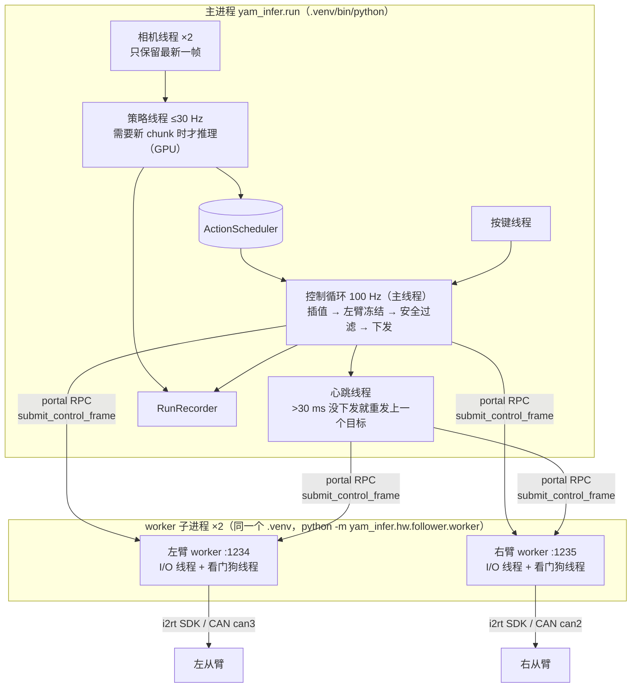
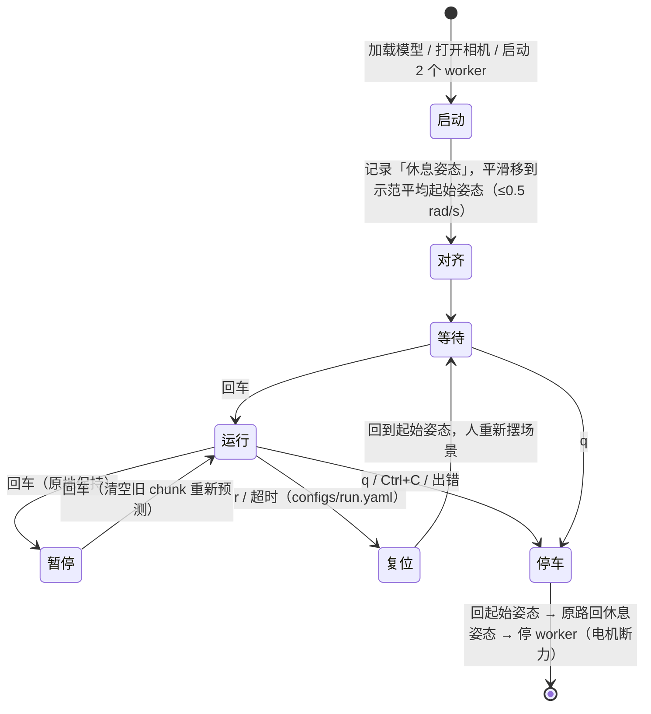
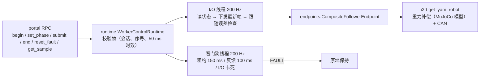
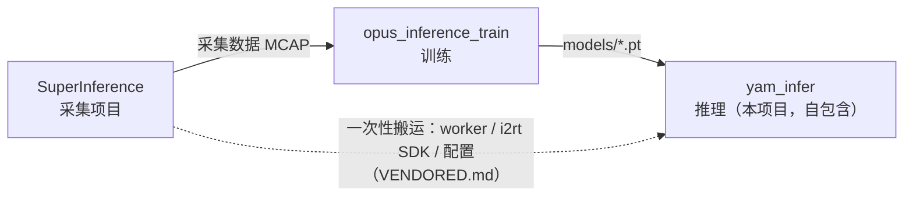

# 02 项目结构与代码说明

> 目标：不读代码，也能知道每个文件做什么、数据怎么流动、出了问题该看哪里。
> 本项目**自包含**：真机运行只需要本仓库 + 本仓库的 `.venv`，不再需要 SuperInference（SI）。

## 1. 目录

```text
yam_infer/
├── README.md               入口：概览 + 快速上手
├── VENDORED.md             从 SI / i2rt 搬来的代码清单与本地改动（改动时更新）
├── AGENTS.md / SEVERS.md   给 AI 助手的约定 / 机器说明
├── pyproject.toml          包信息、pytest / ruff 配置
├── requirements.txt        机器人上的固定版本依赖（torch 除外）
├── pyrightconfig.json      类型检查把 third_party/i2rt 加入路径
├── robot.env.example       机器人本机配置模板（复制为 robot.env，不进 git）
├── configs/
│   ├── hardware.yaml         两只从臂（CAN 口、RPC 端口、看门狗参数）+ 相机序列号
│   ├── rest_pose.yaml        休息姿态（home_arms 的归位目标）
│   └── run.yaml              运行参数（episode.max_seconds 回合时长上限）
├── docs/                   本文档
├── scripts/                一键脚本（见 03_scripts.md）
├── tests/                  不需要硬件的自动测试（pytest）
├── third_party/i2rt/       I2RT 机械臂 SDK（MIT，已裁剪，代码未改）
├── models/                 模型文件 *.pt（不进 git）
└── yam_infer/              Python 包
    ├── run.py                主程序（入口）
    ├── policy/               「大脑」：网络
    │   ├── policy.py           模型加载 + 预处理 + 推理
    │   ├── act.py              ACT 网络结构（与训练端一致）
    │   └── server.py           可选：远程 GPU 推理服务
    ├── control/              「小脑」：动作怎么执行
    │   └── scheduler.py        chunk 调度 + 安全过滤
    ├── hw/                   硬件
    │   ├── arms.py             主进程侧：启动/驱动两个 worker；模拟臂 SimArms
    │   ├── cameras.py          D405 相机；录制回放
    │   └── follower/           worker 进程侧（从 SI 搬来）
    │       ├── worker.py         一个进程 = 一只从臂，RPC 服务
    │       ├── runtime.py        控制循环 + 看门狗（与 SI 逐字节一致）
    │       ├── config.py         hardware.yaml 解析与校验（与 SI 逐字节一致）
    │       └── endpoints.py      i2rt SDK → 7 维接口；FakeFollowerEndpoint
    ├── data/                 读写数据
    │   ├── recorder.py         每回合记录
    │   └── nedf3.py            读采集的 MCAP 录制（离线演练）
    └── tools/                独立小工具
        ├── review.py           复盘
        ├── free_hw.py          谁占着 CAN/相机/端口 → 交互式停止
        ├── home_arms.py        任何状态下把手臂归位再断电
        └── export.py           训练 ckpt → 部署模型
```

| 只在机器人上、不进 git | 说明 |
|---|---|
| `.venv/` | Python 环境（`setup_robot.sh` 生成） |
| `robot.env` | 本机配置（模型路径等） |
| `sample_episodes/` | 离线演练用的录制 |
| `runs_infer/`、`runs_infer_dryrun/` | 推理记录 |

## 2. 进程与线程



为什么 worker 要单独进程：CAN 读写可能卡住，单独进程 + 独立看门狗线程保证「主程序卡住 / 崩溃时，手臂仍会在 150 ms 内进入保持」；主程序死掉时 worker 也会被内核通知退出（`PR_SET_PDEATHSIG`）。

## 3. 一次运行的生命周期（`run.py`）



| 函数 | 作用 |
|---|---|
| `main()` | 解析参数，组装 policy / cams / arms，循环调用 `run_episode`，`finally` 里一定停车 |
| `run_episode()` | 一个回合：等回车 → 起策略线程 → 100 Hz 控制循环 → 写记录。返回 `next` / `quit` |
| `smooth_move()` | 三次 smoothstep 平滑移动，峰值速度受限，至少 2 秒 |
| `park_and_release()` | 停车：失败先 `recover()`（清故障、重开会话）再试一次，然后关 worker |

### 控制循环每 10 ms 做的事


## 4. 模块逐个说明

### `policy/`：网络

| 成员 | 作用 |
|---|---|
| `policy.preprocess_frame()` | 原图 → JPEG q90 编解码 → INTER_AREA 缩放到 240×320（与训练一致） |
| `policy.Policy` | 读 `.pt`，重建 `ACT`，载入权重、归一化统计量、任务列表、起始姿态；GPU 上 bf16 |
| `Policy.predict()` | 两路图像 + 14 维 qpos + 任务名 → `(50, 14)` **绝对**关节目标 |
| `act.ACT` / `ACTConfig` | 网络结构；必须与训练端 `opus_inference_train/opus/model/act.py` 一致 |
| `server.py` | 机器人没 GPU 时远程推理；协议：4 字节长度 + JSON 头 + JPEG（不用 pickle） |

### `control/scheduler.py`

| 类 | 作用 |
|---|---|
| `ActionScheduler` | 存最近的 chunk（带拍照时刻），`target_at(t)` 线性插值。`chunk` 模式执行 `horizon` 步才换，切换 0.1 s 交叉淡化；`ensemble` 模式加权平均 |
| `SafetyFilter` | ① 关节限制在示范范围 ± margin、夹爪 0–1 ② 速度上限（关节 1.5 rad/s、夹爪 3 /s）；统计触发次数 |

### `hw/arms.py`：主进程侧的从臂

| 成员 | 作用 |
|---|---|
| `FollowerArms(hw_config, log_dir, fake=False)` | 检查端口没被占用 → 用本进程的 Python 启动两个 worker（`PYTHONPATH` 加上 `third_party/i2rt`）→ 等端口就绪 → portal RPC |
| `begin / activate / end` | 开会话（ALIGNING）/ 等 worker 应用了对齐帧后切 ACTIVE / 结束会话（原地保持） |
| `submit()` | 下发 14 维目标（拆成左右各 7 维） |
| 心跳线程 | 每 10 ms 检查，>30 ms 没下发就重发，保证 150 ms 租约不过期 |
| `recover()` | FAULT 后：清故障 → 新会话 → 保持当前位置 |
| `close()` | 结束会话 → 终止 worker（**零力矩**），所以一定先停车 |
| 端口占用保护 | 1234/1235 已被别人（如采集 WebUI 的 worker）占用 → 拒绝启动，绝不连到别人的 worker |
| `SimArms` | 离线演练：一阶滞后（约 130 ms）追随目标，不起 worker |
| 日志 | `runs_infer/worker_left.log`、`worker_right.log` |

### `hw/follower/`：worker 进程侧（从 SI 搬来）



| 文件 | 作用 | 与 SI 的关系 |
|---|---|---|
| `worker.py` | 解析参数 → 建 endpoint → 启 runtime → 起 RPC 服务；SIGTERM 时先保持再断电 | 改编（仅从臂、标准 logging、`--fake`） |
| `runtime.py` | 会话/阶段状态机、帧校验、看门狗、跟随误差故障 | 逐字节一致 |
| `config.py` | `hardware.yaml` 严格校验（端口/CAN 唯一、数值范围） | 逐字节一致 |
| `endpoints.py` | i2rt 机械臂 → 7 维 `get_info / command_joint_pos`；`FakeFollowerEndpoint` 给测试用 | 改编（仅 `i2rt_can` 夹爪） |

### `hw/cameras.py`

| 成员 | 作用 |
|---|---|
| `resolve_serials()` | 序列号：命令行 > 环境变量 `YAM_{LEFT,RIGHT}_CAM_SERIAL` > `hardware.yaml` 的 `cameras:` |
| `RealSenseCamera` / `CameraRig` | 后台线程取帧，只保留最新；`grab()` 拒绝超过 0.2 s 的旧帧 |
| `ReplayCameraRig` | 离线演练：按时间回放录制画面 |

### `data/`

`recorder.py` 每回合写一个目录 `runs_infer/<时间>_<任务>/`：

| 文件 | 频率 | 内容 |
|---|---|---|
| `meta.json` | — | 模型信息、全部参数、结束原因、时长、安全层触发次数 |
| `policy.npz` | 每次推理 | `t`、`qpos`、`chunk (50×14)`、`latency_ms` |
| `command.npz` | 100 Hz | `t`、`target_raw`、`target_safe`、`qpos` |
| `frames.mp4` | 每次推理 | 模型实际看到的图像（右 \| 左） |

`nedf3.py` 读 SI 采集格式（MCAP）的录制，只给 `--dry-run` 用。

### `tools/`

| 文件 | 作用 |
|---|---|
| `review.py` | 健康摘要 + `review.png`（每个关节目标/下发/实际），`--video` 生成 `review.mp4` |
| `free_hw.py` | 按真实占用（CAN socket、RPC 端口监听/连接、RealSense 设备、CAN 口状态）找出阻止开机械臂的程序，按所属程序分组，交互式停止；需要时用 sudo |
| `home_arms.py` | 任何 worker 状态下归位：能用现有 worker 就用 RPC；否则调 `free_hw` 释放后起本项目 worker；最后在休息姿态断电 |
| `export.py` | 训练 ckpt 去掉优化器状态 → 部署 `.pt` |

## 5. 配置文件

### `configs/run.yaml`

| 键 | 默认 | 内容 |
|---|---|---|
| `episode.max_seconds` | 40.0 | 单回合最长时间（秒），到时结束本回合；`--max-seconds` 可覆盖 |

### `configs/rest_pose.yaml`

| 键 | 内容 |
|---|---|
| `left` / `right` | 各 7 个数：6 个关节（rad）+ 夹爪（0 闭–1 开）；`home_arms.sh` 的归位目标 |

> `run.py` 退出时回的是**本次启动时**读到的姿态（内存里），不读这个文件。

### `configs/hardware.yaml`

| 段 | 内容 |
|---|---|
| `control` | 看门狗参数：帧时效 50 ms、租约 150 ms、反馈超时 100 ms、跟随误差 1 rad × 3 次 |
| `arms.<side>.follower` | CAN 口（左 can3 / 右 can2）、RPC 端口（1234 / 1235）、夹爪 `i2rt_can` + `crank_4310` |
| `arms.<side>.leader` | 推理不用，格式校验要求存在 |
| `cameras` | `left_wrist` / `right_wrist` 序列号 |

### 模型文件（`.pt`）

| 键 | 内容 |
|---|---|
| `model`, `config` | 权重与 `ACTConfig`（dict） |
| `stats` | qpos 与动作的均值/标准差/最小/最大 |
| `action_mode`, `action_norm` | `abs` / `delta` 及网络输出归一化 |
| `tasks` | 顺序 = 任务编号 |
| `cameras`, `image_size`, `fps` | `[right_wrist, left_wrist]`、240×320、30 |
| `start_pose` | 每个任务示范的平均起始姿态 |

## 6. 与其他项目的关系



| 运行时还和 SI 有关的唯一一点 | 说明 |
|---|---|
| 不能和采集 WebUI 同时运行 | 两者争用同一组 CAN 口、相机和 RPC 端口；`run_robot.sh` 和 `FollowerArms` 都会检测并拒绝 |
