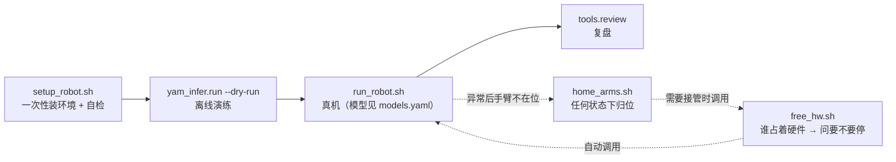
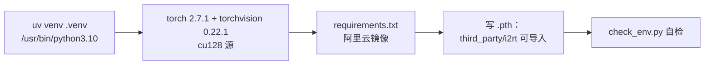
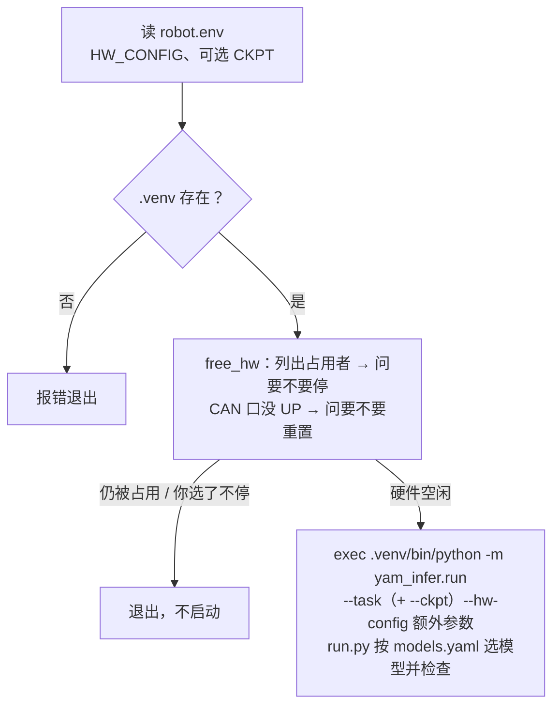
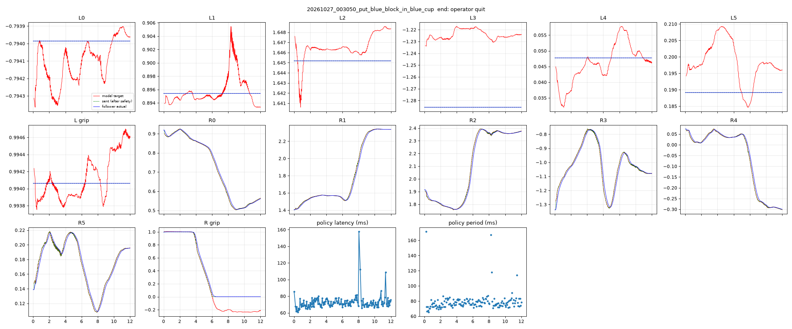
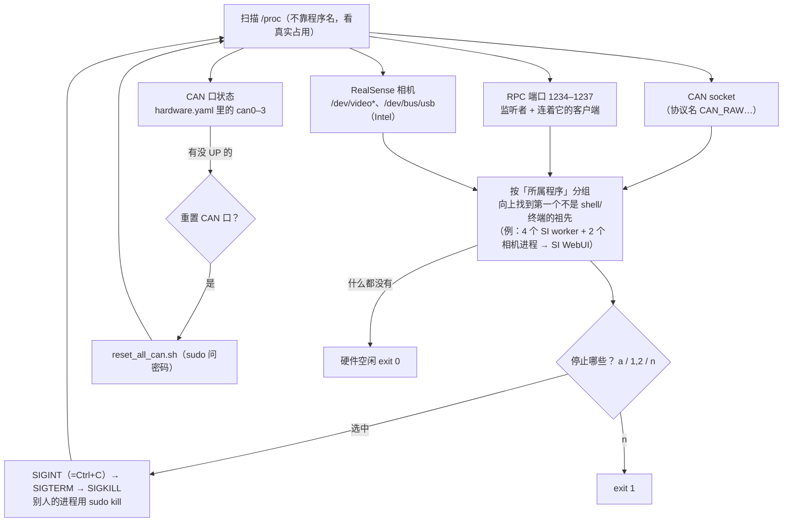
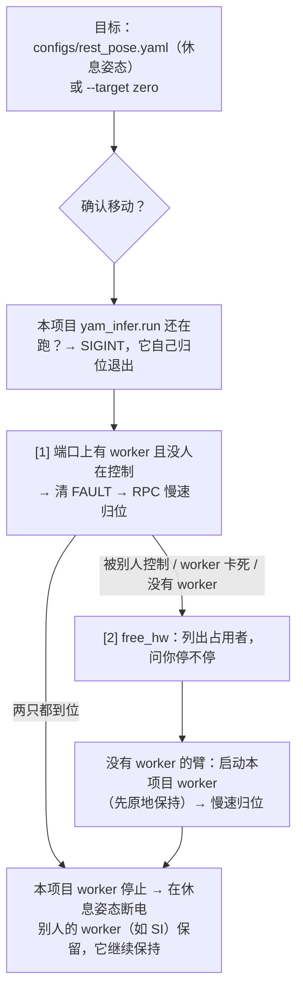

# 03 脚本与命令

> 机器人上的命令都在项目根目录（`~/fufu/yam_infer`）执行。

## 1. 总览



| 命令 | 在哪跑 | 什么时候用 | 动硬件？ |
|---|---|---|---|
| `bash scripts/setup_robot.sh [--dev]` | 机器人 | 第一次 / 依赖变了 / 重建 `.venv` | 否 |
| `.venv/bin/python scripts/check_env.py` | 机器人 | 环境自检（setup 最后会自动跑） | 否 |
| `.venv/bin/python -m pytest -q` | 两边 | 改代码后 | 否 |
| `.venv/bin/python -m yam_infer.run … --dry-run <录制>` | 两边 | 不碰硬件跑一遍全流程 | 否 |
| `bash scripts/run_robot.sh [额外参数]` | 机器人 | 真机运行；模型、任务、增量/绝对都在 `configs/models.yaml` | **是** |
| `.venv/bin/python -m yam_infer.tools.review runs_infer/<目录> --video` | 两边 | 复盘 | 否 |
| `bash scripts/free_hw.sh [--check] [--sudo]` | 机器人 | 开不了机械臂时：列出占用 CAN / 相机 / RPC 端口的程序并问要不要停；CAN 口没 UP 就问要不要重置（`run_robot.sh` 自动调用） | 停程序可能让手臂断力 |
| `bash scripts/home_arms.sh` | 机器人 | 不管 worker 什么状态，把两只手臂慢速归位再断电 | **是** |
| `bash scripts/vendor_diff.sh <SI 目录>` | 用户电脑 | 检查 SI 上游有没有更新 worker / i2rt | 否 |
| `python -m yam_infer.tools.export IN.pt OUT.pt` | 任意 | 训练 ckpt → 部署模型 | 否 |
| `python -m yam_infer.policy.server --ckpt … --host <IP>` | GPU 机 | 机器人没 GPU 时 | 否 |

## 2. `scripts/setup_robot.sh`



| 注意 | 说明 |
|---|---|
| Python 3.10 | 与 i2rt 驱动验证过的版本一致 |
| cu128 | RTX 50 系（5090）只能用 CUDA 12.8 的 torch |
| numpy 2.2.6 | i2rt 固定版本 |
| `--dev` | 额外装 pytest、ruff |
| `PIP_MIRROR=…` | 换 PyPI 镜像 |

`check_env.py` 检查：torch + GPU、numpy/cv2、pyrealsense2/portal、i2rt 依赖、i2rt SDK 能生成 YAM+crank_4310 的 MuJoCo 模型、`hardware.yaml` 端口与相机、`models/*.pt`、worker 模块可导入。最后一行 `ALL OK` 才算通过。

## 3. `scripts/run_robot.sh [额外参数]`



| 变量（`robot.env`） | 默认 |
|---|---|
| `CKPT` | 不设 = 用 `configs/models.yaml` 的模型；临时换同类模型：`CKPT=models/act_v2_delta_s15k.pt bash scripts/run_robot.sh`（仍按 models.yaml 校验格式 / 任务 / 增量绝对） |
| `HW_CONFIG` | `configs/hardware.yaml` |
| `YAM_LEFT_CAM_SERIAL` / `YAM_RIGHT_CAM_SERIAL` | 不设则用 `hardware.yaml` 的 `cameras:` |

### 运行时按键（输入后回车）

| 按键 | 作用 |
|---|---|
| 回车 | 开始 / 暂停 / 继续（暂停时原地保持） |
| `r` | 结束本回合（保存记录）→ 回起始姿态 → 等下一回合 |
| `q` | 回起始姿态 → 原路回休息姿态 → 断力 |
| Ctrl+C（或 SIGTERM） | 中断，同样先归位再断电；归位过程中再按 Ctrl+C 会被忽略（防止半路断电掉臂） |

## 4. `yam_infer.run` 全部参数

| 参数 | 默认 | 说明 |
|---|---|---|
| `--models-config` | `configs/models.yaml` | 模型及其解读方式 |
| `--ckpt` | `models.yaml` 的 `ckpt` | 临时换模型文件 |
| `--task` | `models.yaml` 的 `task` | 临时换任务（旧多任务模型里选另一个） |
| `--hw-config` | `configs/hardware.yaml` | 从臂 + 相机配置 |
| `--left-serial` / `--right-serial` | 配置文件 | 相机序列号覆盖 |
| `--remote host:port` | 关 | 用远程推理服务 |
| `--device` | `auto` | `cuda` / `cpu` |
| `--no-jpeg-roundtrip` | 关 | 跳过 JPEG 编解码（不建议） |
| `--goto-start` | `task_mean` | 每回合前移到示范平均起始姿态；`none` 不动 |
| `--park` | `home` | 退出时：`home` 回休息姿态再断电；`start` 只回起始姿态；`none` 直接断电（**会掉**） |
| `--exec-mode` | 读 `run.yaml` `execution.mode`（chunk） | `chunk` 承诺执行 / `ensemble` 时间集成 |
| `--exec-horizon` | 读 `execution.horizon`（30） | chunk 模式每个计划执行多少步 = 多久重新看图（30 步 = 1 s），1 到模型的 chunk 长度（act_v2 50、act_ref 100） |
| `--blend-s` | 读 `execution.blend_s`（0.1） | chunk 模式换计划时的交叉淡化时长 |
| `--ensemble-m` | 读 `execution.ensemble_m`（0.01） | ensemble 模式权重系数 |
| `--margin` | 0.15 | 允许超出示范范围的弧度 |
| `--max-joint-speed` | 1.5 | rad/s；**新模型第一次上机建议 0.8** |
| `--move-left` | 关 | 允许模型动左臂 |
| `--run-config` | `configs/run.yaml` | 运行参数文件 |
| `--max-seconds` | 读 `run.yaml` 的 `episode.max_seconds`（40） | 单回合最长时间；命令行给了就以命令行为准 |
| `--record-dir` | `runs_infer` | 记录目录 |
| `--dry-run <录制目录>` | 关 | 离线演练：录制画面 + 模拟臂 |
| `--fake-arms` | 关 | 配合 `--dry-run`：模拟臂跑在**真实的 worker 进程**里，走完整 RPC/心跳/看门狗路径 |

## 5. 离线演练

```bash
# 最快：模拟臂在主进程里
.venv/bin/python -m yam_infer.run \
    --dry-run sample_episodes/put_banana_in_bowl/episode_0019 --record-dir runs_infer_dryrun
# 更接近真机：真实 worker 进程 + 模拟臂（端口 1234/1235 必须空闲，采集 WebUI 开着时会被拒绝）
… --fake-arms
```

| 检查 | 期望 |
|---|---|
| 启动 → 对齐 → 回车运行 → r / q | 全流程不报错 |
| `latency` | 机器人 GPU 约 15 ms；用户电脑 CPU 约 150–250 ms |
| 记录目录 | `data/*.mcap、policy.npz、command.npz、events.jsonl、episode_stats.json、meta.json`；`episode_stats.json` 里 `dropped_camera_frames` = 0、`writer_error` = null |



## 6. 复盘

```bash
.venv/bin/python -m yam_infer.tools.review runs_infer/<目录> --video
```

| 输出 | 内容 |
|---|---|
| 终端 JSON | 结束原因、策略频率、延迟 p50/p95、安全层修改比例、右臂跟踪误差；新格式另有丢帧数、写盘错误、图像年龄、各相机帧数 |
| `review.png` | 14 个关节：红 = 模型目标，绿虚线 = 实际下发，蓝 = 从臂实际；延迟、推理间隔、图像年龄 |
| `review.mp4` | 新格式：两路相机**按真实速度**播放（30 fps），被模型用到的那一帧加绿框，下方是当时最新计划的右夹爪曲线；旧格式：模型输入画面 |

```bash
# 离线重跑模型，验证录制能复现网络输出（机器人上用 --device cuda 和现场一致）
.venv/bin/python -m yam_infer.tools.replay_policy runs_infer/<目录> --ckpt models/act_v2_all.pt
# 推理录制本身也是 NEDF3，可以直接当离线演练的输入
.venv/bin/python -m yam_infer.run --dry-run runs_infer/<目录>
```

| 目录 | 含义 |
|---|---|
| `runs_infer/<时间>_<任务>/` | 完整回合 |
| `runs_infer/quarantine/` | 不完整的回合（缺数据、写盘出错、程序中途崩溃），原因见 `quarantine_reason.json` |

| 现象 | 看哪里 | 可能原因 / 处理 |
|---|---|---|
| 动作卡顿 | `latency_ms_p95` > 33 | 推理太慢 → `--remote` |
| 动作被截断 | `frac_commands_changed_by_safety_or_freeze.right_arm` 高 | 模型越界或太快 → 调 `--margin` / 速度 |
| 实际跟不上目标 | review.png 蓝线落后红线 | 正常约 130 ms；更大看 worker 日志 |
| 停住不动 | review.png 右臂曲线变平；`end_reason` = max_seconds | 调大 `--exec-horizon`；或模型能力 |
| 抓错物体 | review.mp4 | 补数据再训练 |

## 7. `scripts/free_hw.sh`：谁占着硬件



| 选项 | 作用 |
|---|---|
| （无） | 列出 → 问 → 停 → 重新扫描，直到空闲或你选择不停 |
| `--check` | 只列出，不停任何东西；忙则 exit 1 |
| `--sudo` | 用 sudo 扫描其他用户的进程（普通扫描看不到别人进程的文件句柄）。发现「端口被占但找不到是谁」时会自动问要不要 |
| `--hw-config` | 读端口和 CAN 口名 |

| 输出标记 | 含义 |
|---|---|
| `[本项目]` | `yam_infer.run` 或本项目 worker |
| `! 它在控制机械臂` | 有 CAN socket：停掉它电机就断力，**手臂会落下** → 想先归位用 `home_arms.sh` |
| `连着 RPC 端口` | 它是控制者（如 WebUI 的协调器、推理程序） |

## 8. `scripts/home_arms.sh`：任何状态下归位



| 选项 | 作用 |
|---|---|
| `--target rest`（默认）/ `zero` | `configs/rest_pose.yaml` / 关节全 0、夹爪张开 |
| `--rest-pose <yaml>` | 换一个休息姿态文件 |
| `--speed 0.4` | 归位峰值速度 rad/s |
| `--keep-on` | 归位后保持通电，Ctrl+C 才断电 |
| `--yes` | 不问确认 |
| `--fake` | 模拟 worker（测试用） |

> 安全细节：只在 worker 没有被别人控制时才接管（先 `get_status`，不会发出会被拒绝的请求——worker 收到被拒绝的请求会直接退出、手臂落下）。

## 9. 远程推理（可选）

```bash
# GPU 机器
python -m yam_infer.policy.server --ckpt models/act_v2_all.pt --host <局域网 IP> --port 5555
# 机器人
bash scripts/run_robot.sh --remote <GPU 机 IP>:5555
```
