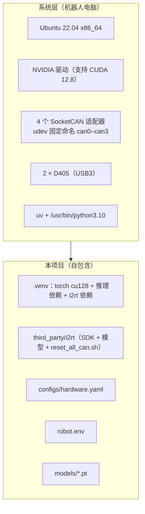
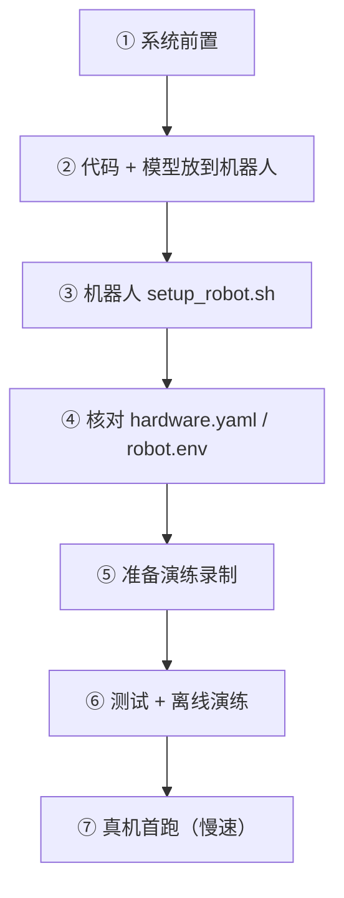

# 04 从零配置环境

## 1. 依赖关系



> 不再需要 SuperInference 项目或它的 `.venv`。唯一要求：运行时**采集 WebUI 必须关闭**（争用 CAN、相机、RPC 端口）。

## 2. 当前机器人电脑（参考值，2026-10-28 验证）

| 项 | 值 |
|---|---|
| 登录 | `ssh team1@10.128.1.165` |
| 系统 | Ubuntu 22.04.5，内核 6.8 |
| GPU | RTX 5090，驱动 595.99 |
| uv | `/snap/bin/uv` 0.12（非交互 ssh 时 PATH 里可能没有 `/snap/bin`） |
| Python | `/usr/bin/python3.10`（3.10.12） |
| 项目位置 | `~/fufu/yam_infer`（`check_env.py` 全部 OK，15 个测试通过） |
| `.venv` | torch 2.7.1+cu128、numpy 2.2.6、mujoco 3.16.0、python-can 4.5.0、portal 3.7.3 |
| CAN | 左从臂 can3、右从臂 can2（`/etc/udev/rules.d/90-can.rules`） |
| 相机 | 左腕 `262622275249`，右腕 `262622272890`（写在 `configs/hardware.yaml`） |
| 旧部署 | `~/fufu/opus_inference_train`（依赖 SI，保留不动，可作对照） |

## 3. 步骤



### ① 系统前置（新机器才需要）

```bash
nvidia-smi                       # 驱动需支持 CUDA 12.8
uv --version                     # 没有：sudo snap install astral-uv --classic
/usr/bin/python3.10 -V
sudo apt install -y can-utils libgl1 libglib2.0-0
ip -br link | grep can           # 4 个 CAN 口；名字要和 hardware.yaml 对上
rs-enumerate-devices -s          # 两个 D405 的序列号（或用 pyrealsense2 查）
```

| 新机器额外要做 | 说明 |
|---|---|
| CAN 命名固定 | 写 udev 规则，按 USB 序列号把 4 个适配器固定为 can0–can3（参考 SI 的 `deploy_sop.md` 第 6 节）；左从臂 = can3、右从臂 = can2，不同就改 `hardware.yaml` |
| 相机序列号 | 写进 `hardware.yaml` 的 `cameras:` |
| D405 USB 权限 | 装 librealsense udev 规则，或确认普通用户能打开相机 |

### ② 代码 + 模型放到机器人

| 内容 | 方式 |
|---|---|
| 代码 | git（放到 `~/fufu/yam_infer`） |
| 模型 `models/*.pt` | 不进 git，单独拷贝（约 200 MB/个） |

> 不要拷 `.venv`（见 ③）。

### ③ 安装（机器人）

```bash
cd ~/fufu/yam_infer
bash scripts/setup_robot.sh --dev         # 最后一行应是 ALL OK
```

| 失败现象 | 处理 |
|---|---|
| `uv: command not found` | `export PATH=/snap/bin:$PATH` |
| torch 下载慢 / 超时 | download.pytorch.org 国内慢 → 这一条命令加代理重试；uv 有缓存时很快 |
| `torch … NO CUDA` | 驱动不支持 12.8 或装成了 CPU 版 → 确认 `--index-url …/cu128` |
| `pyrealsense2` 装不上 | 必须 x86_64 + Python 3.10 |
| `i2rt SDK` 检查失败 | `third_party/i2rt` 没同步全，或 mujoco 没装上 |

> 不要从别的目录复制 `.venv`：venv 里写死了绝对路径，换目录会失效。

### ④ 核对配置

```bash
cp -n robot.env.example robot.env         # 默认模型 models/act_v2_all.pt
```

| 文件 | 核对 |
|---|---|
| `configs/hardware.yaml` | CAN 口、相机序列号与本机一致 |
| `robot.env` | `CKPT` 指向要用的模型 |

### ⑤ 演练录制

```bash
cp -r ~/fufu/opus_inference_train/sample_episodes .       # 本机已有两条
# 或从采集数据挑一条：<SI>/data/<任务>/episode_XXXX
```

### ⑥ 测试 + 离线演练（不动硬件）

```bash
.venv/bin/python -m pytest -q
.venv/bin/python -m yam_infer.run --ckpt models/act_v2_all.pt --task put_banana_in_bowl \
    --dry-run sample_episodes/put_banana_in_bowl/episode_0019 --record-dir runs_infer_dryrun
# 采集 WebUI 关着时，再加 --fake-arms 走一遍真实 worker 进程
```

### ⑦ 真机首跑

| 检查 | |
|---|---|
| 采集 WebUI 已关闭 | SI `start.sh` 的终端 Ctrl+C |
| 场景已摆好 | 桌面恢复到任务初始状态 |
| 人在急停旁 | 必须 |

```bash
bash scripts/run_robot.sh banana --max-joint-speed 0.8
```

## 4. 常见问题

| 提示 / 现象 | 原因 | 处理 |
|---|---|---|
| `run_robot.sh` 列出占用者 | CAN / 相机 / 端口被别的程序占着（如采集 WebUI） | 按提示选择停止；想先把手臂放好再停 → `bash scripts/home_arms.sh` |
| `follower RPC port already in use` | 同上（别的 worker 占了 1234/1235） | 同上 |
| 「CAN 口未就绪」 | CAN 口 DOWN | 选择重置，输入 team1 的 sudo 密码 |
| `follower workers not ready after 30s` | worker 启动失败 | 看 `runs_infer/worker_*.log`；常见：CAN 不通、电机没上电 |
| `follower FAULT: …` | worker 看门狗触发（跟随误差 / 租约 / 反馈超时 / 电机过热） | 看 worker 日志；`bash scripts/home_arms.sh` 归位 |
| 相机报错 / 黑图 | 序列号不对或插在 USB2 口 | 核对 `hardware.yaml`；`--left-serial/--right-serial` |
| GPU 被他人占用 | — | 模型只需约 1 GB 显存 |
