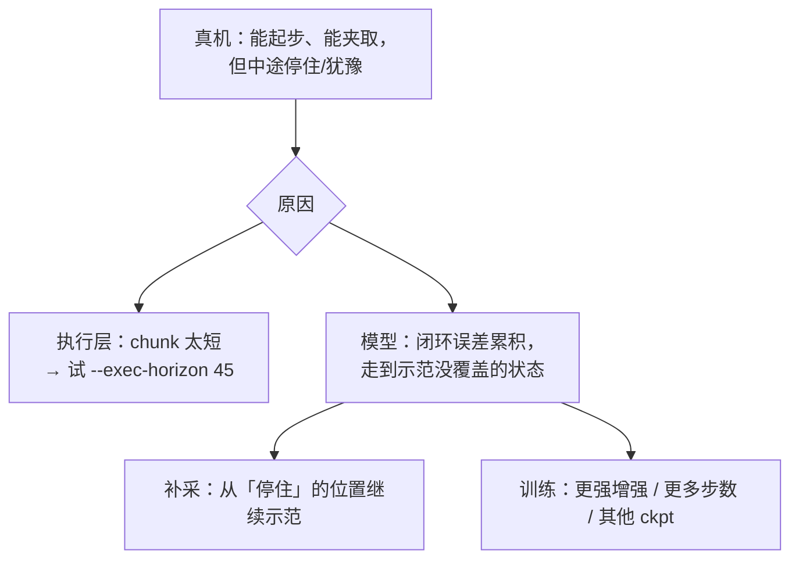

# 05 真机记录与问题跟踪

> 10-28 之前的记录来自机器人 `~/fufu/opus_inference_train/runs_infer/`（上游部署，依赖 SI 的 worker；推理逻辑与本项目一致）。

## 已验证

| 检查 | 结果 |
|---|---|
| GPU 推理延迟 | 约 9–15 ms |
| 两路 D405 出图 | ✅ 640×480，颜色正确 |
| 真机启动 → 对齐 → 运行 → 归位断电 | ✅ |
| 真机完成任务（上游 opus_inference_train） | ✅ 用户确认已跑成功（10-28） |
| 本项目独立版：环境自检 / 15 个测试 / 离线演练（GPU） | ✅ 机器人 `~/fufu/yam_infer`（10-28） |
| 本项目独立版：`--fake-arms` 真实 worker 进程 | ✅ 用户电脑；机器人上当时采集 WebUI 占用端口，被正确拒绝 |
| **本项目独立版：真机** | ⏳ 待测（worker 与 SI 同逻辑，但换成本项目 `.venv` + 裁剪版 i2rt） |

## 时间线

| 时间 | 任务 | 结果 | 原因 / 处理 |
|---|---|---|---|
| 10-27 22:16 | block | 抓起蓝块后停住（60 s 超时） | 「等一下再动」的预测被每步重规划无限推迟 → 改为 **chunk 承诺式执行** |
| 10-27 22:19 | banana | 一开始就不动 | 同上 |
| 10-27 22:3x | banana | 等回车期间 worker 故障、断力 | 等待期间没发指令，租约过期 → 加**心跳线程** |
| 10-27 22:37 | banana | 夹起香蕉 ✅，搬运时原地悬停 ❌ | 模型问题：夹住后 R0 只转 0.17 rad（示范平均 0.39）就失去方向 |
| 10-27 22:53 | block | 右夹爪电机**过热**关停 → 右臂故障，左 worker 残留 | 长时间夹持挤压 → 加**挤压上限、卡住检测、stop_all、worker 随主程序退出** |
| 10-27 23:04 | block | 40 s 超时，挤压上限触发 3555 次 | 保护生效；任务未完成 |
| 10-28 19:09 | block | 40 s 超时，挤压上限触发 391 次 | 任务未完成 |
| 10-28 19:11–19:13 | banana ×3 | 分别在 19 s / 36 s / 20 s 被**卡住检测**结束 | 右臂 10 s 内移动 < 0.08 rad；模型停在中途 |

## 独立版首次真机检查单

| 步骤 | 期望 |
|---|---|
| 关闭采集 WebUI → `bash scripts/run_robot.sh banana --max-joint-speed 0.8` | worker 日志 `runs_infer/worker_*.log` 出现 `ready on 127.0.0.1:1234/1235` |
| 启动后手臂 | 原地保持（不掉、不跳），再平滑移到起始姿态 |
| 回车运行 | 动作与旧部署一致 |
| `q` | 回休息姿态后断力 |
| 出问题 | Ctrl+C（会自己归位）/ `bash scripts/home_arms.sh`；临时回退到 `~/fufu/opus_inference_train` 的旧部署 |

## 设置变更

| 时间 | 变更 | 原因 |
|---|---|---|
| 10-28 | **去掉卡住检测**（右臂 10 s 不动结束回合） | 听模型的，不替它判断「卡住」；回合只由 `r` / `q` / 超时（`configs/run.yaml`）结束 |
| 10-29 | **录制改为 NEDF3 兼容格式** | 每一帧相机 + 每次关节读数都录；网络输入输出 + 帧号引用；事件流；完整性检查与 quarantine；worker 日志按回合保存（详见 02_architecture.md） |
| 10-29 | **图像↔关节时间对齐** | 关节不再取最新读数，而是按图像到达时间从最近 1 s 的记录中插值（与训练数据转换一致）；动作从图像时刻开始排时间 |
| 10-28 | **去掉夹爪挤压上限**（`--max-grip-squeeze`，夹爪目标最多比实际窄 0.1） | 夹爪完全听模型的；只剩范围（0–1）和速度（3 /s）限制 |

## 当前判断（10-28 之前）

## 下一步要收集的反馈

| 内容 | 怎么做 |
|---|---|
| 每个任务 10 次的成功次数 | 每回合结束按 `r`，记下成败 |
| 失败回合目录 | 整个 `runs_infer/<目录>` 拷回用户电脑，用 `yam_infer.tools.review --video` 分析 |
| 执行参数对比 | 同一场景下 `--exec-horizon 30 / 45`、`--exec-mode ensemble` 各试几次 |
