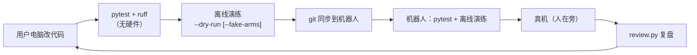

# 06 持续开发指南

## 1. 开发循环

| 步骤 | 命令（项目根目录） |
|---|---|
| 测试 | `.venv/bin/python -m pytest -q` |
| 代码检查 | `uvx ruff check .`（或 `.venv/bin/ruff check .`） |
| 离线演练 | `.venv/bin/python -m yam_infer.run --ckpt models/act_v2_all.pt --task put_banana_in_bowl --dry-run <录制> [--fake-arms]` |

> 用户电脑的 `.venv` 是 Python 3.12 + CPU torch，只用于开发和离线验证；机器人用自己的 `.venv`（`setup_robot.sh` 生成），两边不能互相复制。

## 2. 测试覆盖

| 文件 | 测什么 | 需要 |
|---|---|---|
| `tests/test_follower_runtime.py` | worker 看门狗：会话/序号/时效、租约过期、反馈超时、跟随误差、I/O 卡死（移植自 SI） | 无 |
| `tests/test_arms_fake_worker.py` | `FollowerArms` ↔ 真实 worker 进程（`--fake`）：启动、阶段切换、心跳保活、关闭；端口被占时拒绝 | 无（自动选空闲端口） |
| `tests/test_scheduler.py` | chunk 调度、交叉淡化、安全过滤（范围/速度） | 无 |
| `tests/test_state_history.py` | 图像↔关节对齐：按时间插值、超范围取边界、只保留 1 s、时间递增 | 无 |
| `tests/test_recorder.py` | 录制：我们的 NEDF3 读取器能读、JPEG 与模型预处理逐字节一致、帧号引用、缺数据进 quarantine、空回合不留目录、崩溃回合下次启动被隔离 | 无 |
| `tests/test_run_config.py` | `run.yaml` 读取：默认值、缺键 / 多余键 / 超范围报错 | 无 |
| `tests/test_tools.py` | `free_hw` 识别占用端口的 worker、解析 `python -u -m …`；`home_arms` 在「没有 worker」「有残留 worker」两种状态下都能归位且不留进程 | 无 |

新功能请顺手加测试；涉及硬件的部分用 `FakeFollowerEndpoint` / `--fake` 模拟。

## 3. 常见改动该动哪里

| 想做的事 | 改哪里 | 注意 |
|---|---|---|
| 换模型 | `models/` 放新 `.pt`，`robot.env` 改 `CKPT` | 新模型首次上机 `--max-joint-speed 0.8` |
| 网络结构变了 | `yam_infer/policy/act.py` 与训练端同步 | 旧模型要还能加载就保持参数名不变 |
| 新任务 | 训练端加任务 → 模型 `tasks` 自带；`run.py` 的 `--task` choices、`run_robot.sh` 的别名 | |
| 预处理变了 | `policy/policy.py: preprocess_frame` | 必须与训练端完全一致 |
| 执行策略（chunk/ensemble/新方法） | `control/scheduler.py` | 先在 `test_scheduler.py` 写用例 |
| 调执行参数（现场调试） | `configs/run.yaml` 的 `execution`，或命令行 `--exec-mode / --exec-horizon / --blend-s / --ensemble-m` | 先调 `horizon`，再试 `mode`；效果看 `review.py` 和录制的 `meta.json` |
| 安全限制 | `control/scheduler.py: SafetyFilter`、`run.py` 参数默认值 | 改默认值同时更新 `03_scripts.md` |
| 看门狗参数 | `configs/hardware.yaml` 的 `control:` | 改小租约前确认心跳间隔（30 ms） |
| CAN 口 / 相机换了 | `configs/hardware.yaml` | |
| worker 行为 | `hw/follower/` | 改了要在 `VENDORED.md` 记录本地改动；`runtime.py` / `config.py` 尽量保持与 SI 一致 |
| 记录更多数据 | `data/recorder.py`（npz 字段）或 `data/nedf3_writer.py`（MCAP 话题）+ `tools/review.py` | 改了 MCAP 话题要保证 `data/nedf3.py` 仍能读；SI 若改 schema，用 `scripts/extract_nedf3_schemas.py` 重新提取 |

## 4. 上游更新

| 上游 | 怎么跟 |
|---|---|
| SuperInference 的 worker / i2rt SDK | `bash scripts/vendor_diff.sh ~/Dev/MVIG/SuperInference-feat-i2rt_NEDF3`：`runtime.py`、`config.py` 不一致就逐字同步；`endpoints.py`、`worker.py` 手动合并；更新 `VENDORED.md` 的提交号 |
| 训练项目 `opus_inference_train` | 新模型 → `python -m yam_infer.tools.export` 去掉优化器 → `models/` |

## 5. 约定

| 项 | 约定 |
|---|---|
| 不进 git | `.venv/`、`models/*.pt`、`robot.env`、`runs_infer*/`、`sample_episodes/` |
| 真机 | 用户电脑无硬件；真机测试只在机器人上、且有人在旁 |
| 不改 SI | SI 项目只读；需要的东西复制进来并记在 `VENDORED.md` |
| 文档 | mermaid + 表格；改参数默认值 / 脚本行为时同步 `docs/03_scripts.md` |
